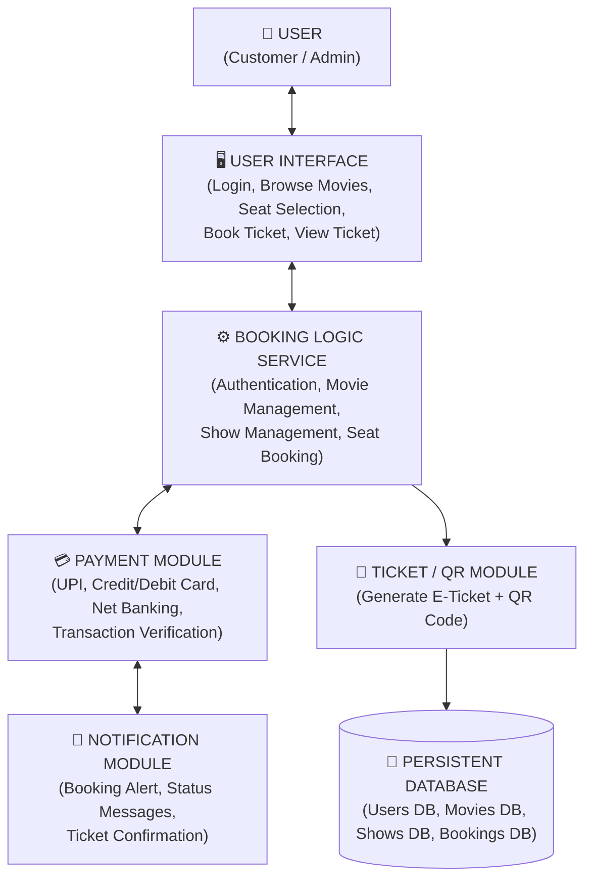
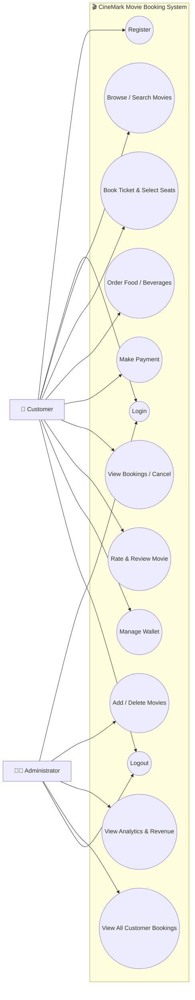
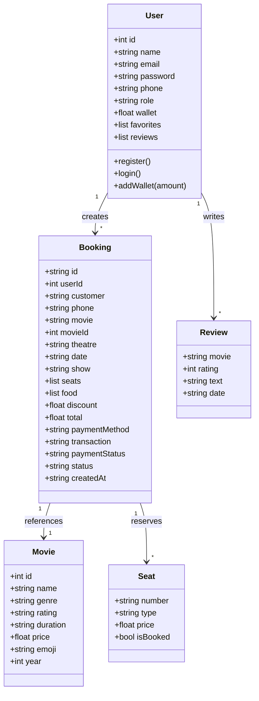
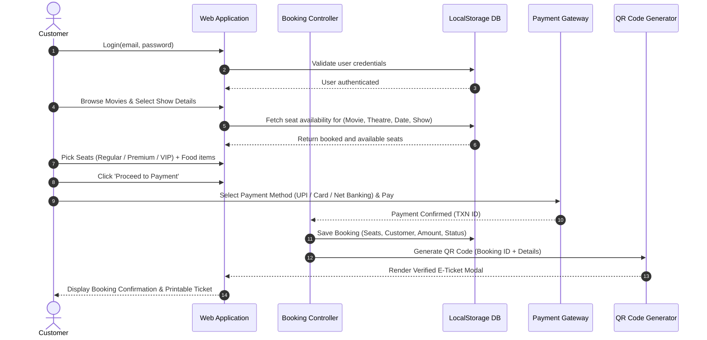
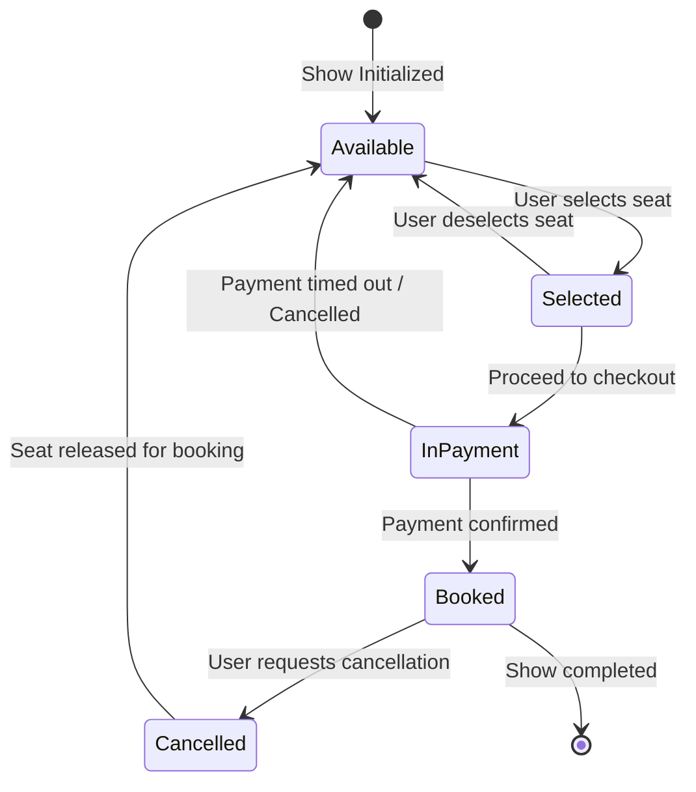
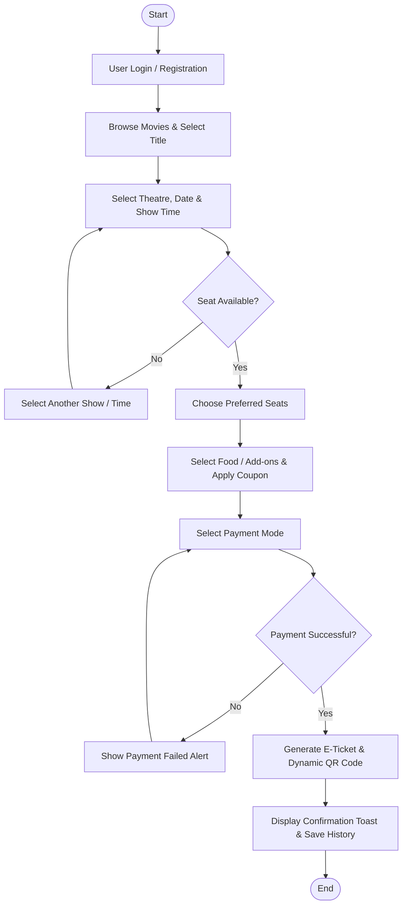

# 🎬 CineMark Theatre - Movie Ticket Booking System

An interactive, responsive, web-based Movie Ticket Booking System designed using Object-Oriented Analysis and Design (OOAD) principles.

---

### 🏛️ Institution
**K. Ramakrishnan College of Technology (Autonomous), Trichy**  
**Department:** Computer Science and Engineering / Information Technology  
**Course / Subject:** Object-Oriented Analysis and Design (OOAD) Project  

### 👥 Team Members
* **Arul Neelakandan T**
* **Aswanth S**
* **Aswin Kumar MR**
* **Balaji B**

---

## 📑 Table of Contents
1. [Abstract](#-abstract)
2. [Introduction](#-introduction)
3. [Existing System vs Proposed System](#-existing-system-vs-proposed-system)
4. [System Architecture](#-system-architecture)
5. [UML Diagrams](#-uml-diagrams)
   - [Use Case Diagram](#1-use-case-diagram)
   - [Class Diagram](#2-class-diagram)
   - [Sequence Diagram](#3-sequence-diagram)
   - [State Diagram](#4-state-diagram)
   - [Activity Diagram](#5-activity-diagram)
6. [Modules Description](#-modules-description)
7. [Features & Tech Stack](#-features--tech-stack)
8. [Demo Credentials](#-demo-credentials)
9. [How to Run](#-how-to-run)
10. [Conclusion](#-conclusion)

---

## 📄 Abstract
The **Movie Ticket Booking System** is an online web application that allows users to search for movies, check show timings, select tier-based seats (Regular, Premium, VIP), order refreshments, apply coupons, and book tickets conveniently. The system automates theatre operations, ticket management, and simulated payment processing. Using object-oriented concepts and UML design, the application provides a secure, scalable, and user-friendly platform that minimizes manual counter work, eliminates double-booking errors, and provides instant E-Ticket generation with verifiable QR codes.

---

## 📌 Introduction
The system enables customers to browse currently running movies, view show timings, and reserve seats through a single unified digital platform.
* Users can register, log in, select seats in real-time, order food combos, make online payments, and receive booking confirmations instantly.
* All movie schedules, customer profiles, wallet balances, and booking records are stored reliably in centralized persistent client storage (`localStorage`).
* The system reduces waiting time at physical counters, avoids duplicate seat booking conflicts, and supports multi-theatre and show management seamlessly.

---

## ⚖️ Existing System vs Proposed System

| Feature | Existing Manual Counter System | Proposed Online System |
| :--- | :--- | :--- |
| **Booking Mechanism** | Physical queues at ticket counter | 24/7 web-based anytime booking |
| **Seat Availability** | No real-time visual seat availability | Dynamic visual seat layout with tier classification |
| **Double Booking** | High chance of human errors and conflicts | Automated locking & real-time booked status check |
| **Payments** | Cash/manual card swiping at desk | Multiple integrated payment gateways (UPI, Cards, Net Banking) |
| **E-Tickets & QR** | Paper tickets prone to loss or damage | Digital E-Ticket with scannable QR verification |
| **Administration** | Paper registers and manual logs | Centralized Admin Dashboard for movies, analytics & revenue |

---

## 🏗️ System Architecture



---

## 📊 UML Diagrams

### 1. Use Case Diagram


### 2. Class Diagram


### 3. Sequence Diagram


### 4. State Diagram


### 5. Activity Diagram


---

## 🧩 Modules Description

1. **User Management Module:**
   - Registration and secure authentication for customers and administrators.
   - Profile management with editable personal details.
   - Integrated CineMark Wallet balance system with instant top-up options.

2. **Movie Management Module:**
   - Display catalog of latest releases with ratings, duration, genre, and starting price.
   - Real-time movie search filter by title or genre.
   - Admin features to dynamically add new movies or remove old titles.

3. **Theatre and Show Management Module:**
   - Supports multiple cinema locations (PVR Cinemas, INOX Phoenix, AGS Cinemas, Rohini Silver Screens, Galaxy Multiplex).
   - Date picker with past date restrictions.
   - Multiple daily showtimes (10:00 AM, 01:30 PM, 04:30 PM, 07:30 PM, 10:30 PM).

4. **Seat Booking Module:**
   - Interactive 100-seat theatre auditorium grid (Rows A-J, Columns 1-10).
   - Multi-tier seat pricing:
     - **Regular:** Rows A-C (₹150)
     - **Premium:** Rows D-G (₹200)
     - **VIP:** Rows H-J (₹300)
   - Real-time conflict avoidance (already booked seats are locked and highlighted in red).

5. **Refreshment & Food Order Module:**
   - Add popcorn, beverage combos, nachos, burgers, pizzas, and ice creams directly to the cart.
   - Discount coupons: `CINE50` (₹50 off), `CINE100` (₹100 off on orders ₹500+), `MOVIE20` (20% off).

6. **Payment Module:**
   - Simulated payment modal supporting UPI, Credit Card, Debit Card, and Net Banking.
   - Automatic unique Transaction ID generation.

7. **Ticket Generation & QR Module:**
   - Instant digital ticket generation with customer info, movie details, seat numbers, and total paid.
   - Real-time QR Code rendering powered by `qrcode.js`.
   - Browser print functionality for physical or PDF ticket export.

8. **Admin Dashboard Module:**
   - Live metrics: Total Users, Total Bookings, Confirmed Bookings, Cancelled Bookings, and Total Revenue (₹).
   - Full master table of all bookings with real-time status.

---

## 💻 Features & Tech Stack

* **Frontend:** HTML5, CSS3 (Modern dark-mode UI with responsive CSS Grid & Flexbox)
* **Logic & Scripts:** Vanilla JavaScript (ES6+ Classes, Event-driven architecture)
* **Libraries:** [QRCode.js](https://cdnjs.cloudflare.com/ajax/libs/qrcodejs/1.0.0/qrcode.min.js) for high-resolution client-side QR generation
* **Storage:** Browser `localStorage` for offline-capable, zero-backend persistence

---

## 🔑 Demo Credentials

| Role | Email | Password |
| :--- | :--- | :--- |
| **Customer** | `user@gmail.com` | `1234` |
| **Administrator** | `admin@cinemark.com` | `admin123` |

---

## 🚀 How to Run

1. **Clone the repository:**
   ```bash
   git clone https://github.com/aswinkumarmr2007-web/Movie-Ticket-Booking-System.git
   cd Movie-Ticket-Booking-System
   ```

2. **Open the application:**
   - Simply double-click `index.html` or open it in any modern browser (Chrome, Firefox, Edge, Safari).
   - Alternatively, serve via VS Code Live Server or Python HTTP server:
     ```bash
     python -m http.server 8000
     ```
   - Open `http://localhost:8000` in your browser.

---

## 🏁 Conclusion
The Movie Ticket Booking System provides an efficient, reliable, and user-friendly solution for managing movie ticket reservations. It automates booking, payment, and ticket generation while reducing manual work and booking errors. The centralized system improves customer convenience, enhances theatre management, and supports future expansion with online payment gateways, multiple theatre management, and real-time seat availability.
